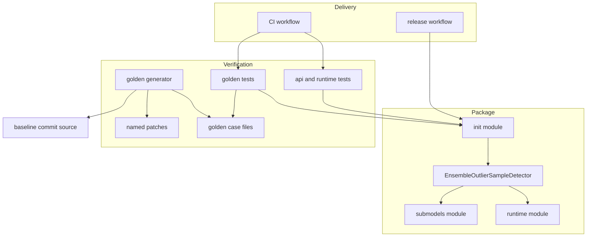
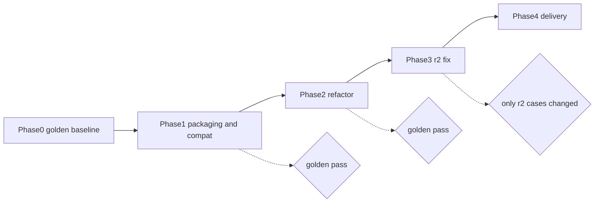
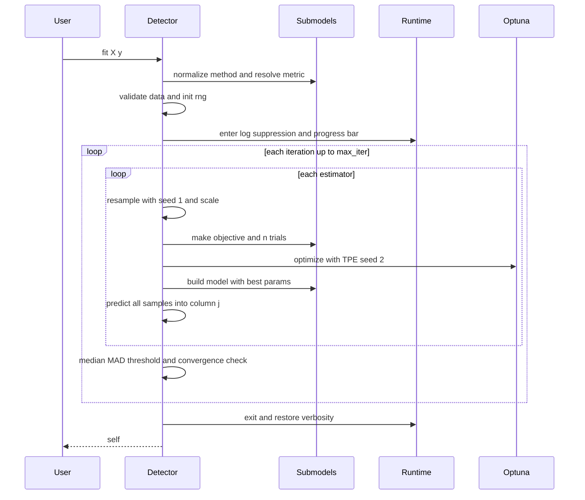
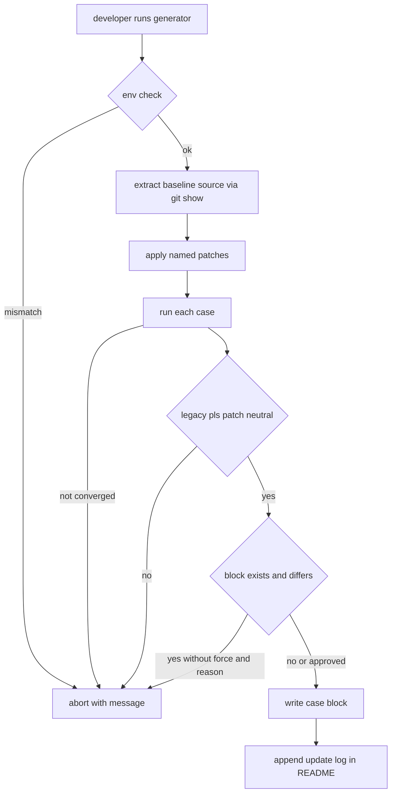

# Design Document: modernize-with-golden-tests

## Overview

**Purpose**: `ensemble-outlier-sample-detection` を、最新の Python と依存ライブラリで動き、テスト・静的解析・CI に守られたライブラリにする。変更前の検出結果を golden として固定し、その一致を確かめながら、パッケージングのモダン化と scikit-learn の estimator 規約への準拠を進める。

**Users**: メンテナーは、golden テストと CI を使って安全に変更とリリースを行う。利用者は、Python 3.10 以上の環境で `pip install` し、scikit-learn の他の estimator と同じ作法で検出器を使う。

**Impact**: flat layout と `setup.py` の構成を、src-layout と `pyproject.toml` に置き換える。1 ファイルにまとまった実装を、公開モジュール 1 つと private モジュール 2 つに分ける。`fit` の戻り値、`n_iter_` の意味、例外の種類が変わるので、1.0.0 として破壊的変更のリリースにする。

### Goals
- 変更前のコードの検出結果を、2021 年環境の golden と最新環境の golden の 2 層で固定し、すべての変更で自動的に照合する
- Python 3.10〜3.14 と、それぞれで入る最新の依存ライブラリで、非推奨警告を出さずに動かす
- scikit-learn 規約に準拠させ（`fit` は self を返す、引数を書き換えない、`clone` と再学習ができる、未収束時は警告を出す）、副作用もなくす
- CI でテスト・lint・型チェックを行い、タグの push で PyPI / TestPyPI / GitHub Release に公開する

### Non-Goals
- アルゴリズムの変更（R² の引数順と SVR の予測形状の修正を除く）、手法や評価指標の追加、高速化
- Sphinx ドキュメント、devcontainer / Docker、conda-forge での配布、依存の下限バージョンでのテスト
- `CLAUDE.md` と `.kiro/steering/` の更新（実装が終わった後に `/kiro-steering` で同期する）

## Boundary Commitments

### This Spec Owns
- 公開 API `EnsembleOutlierSampleDetector` の契約（引数、`fit` の戻り値、学習後の属性、例外、警告）と、その実装
- golden の資産一式（生成スクリプト、名前付きパッチ、環境定義、case ファイル、更新履歴）と、golden の更新ルール
- パッケージのメタデータとビルド設定（`pyproject.toml`、`MANIFEST.in`、`.gitignore`、`py.typed`）
- 静的解析の設定（`ruff.toml`、`mypy.ini`）と、GitHub Actions のワークフロー（CI、release、dependabot）
- 利用者向けドキュメント（README、CHANGELOG、HOW_TO_RELEASE）と example notebook

### Out of Boundary
- PyPI / TestPyPI での trusted publisher の登録と、GitHub の environment（`pypi`、`testpypi`）の作成。メンテナーが手作業で行う
- 2021 年環境と最新環境の conda / pip 環境そのものの作成。メンテナーがローカルで作る。CI では golden を生成しない
- 依存ライブラリ（Optuna、scikit-learn など）の挙動の変化そのもの。本 spec が持つのは、変化を検出して承認付きで golden を更新する手順まで
- 外れ値の判定基準（3 × 1.4826 × MAD）と、ハイパーパラメータの探索範囲の変更

### Allowed Dependencies
- 実行時: numpy、scikit-learn、optuna、tqdm。pandas は実行時依存から外し、テスト用と example 用の追加依存にだけ置く
- テスト: pytest、pandas、参照データ `example/example_chache.csv`
- golden の生成: git CLI と、基準コミット `072d1dfe7ff79b4ebcc411f2b5c13269697e7eac` のソース。インストール済みのパッケージには依存しない
- モジュールの依存方向は「`_runtime` / `_submodels` → `ensemble_outlier_sample_detection` → `__init__`」の一方向とする。private モジュール同士は互いに import しない

### Revalidation Triggers
- 公開 API の契約（引数、属性、例外、戻り値）を変える
- RNG から seed を引く順序、探索空間（パラメータの順序と範囲）、試行回数の規則を変える。golden が一致しなくなる
- golden の case ファイルのスキーマ、名前付きパッチ、基準コミットを変える
- 参照データ（CSV）を変える。case ファイルの `sha256` で検出する
- Optuna をメジャーバージョンで更新する、または対応する Python の範囲を変える

## Architecture

### Existing Architecture Analysis
- 現状は `EnsembleOutlierSampleDetector` が全処理を持ち、`Objective` は検出器への後方参照を通じて、bootstrap ごとの状態（`X_bootstrapped`、`scaler_y` など）を読んでいる。この密結合をやめ、必要な値を引数で受け取る closure に変える
- golden を一致させるために保つ不変条件は次の 6 つ（P1〜P6、詳しくは research.md §1.2）
  - **P1**: RNG から seed を引く順序（bootstrap ごとに、resample → TPE の順で `randint(2**32)` を 2 回）
  - **P2**: PLS の `max_components` は、bootstrap と反復をまたいで累積的な最小値として扱う
  - **P3**: MAD の式（参照実装と同じ）
  - **P4**: 収束条件（mask が前回と同じ、または inlier が 0 件）
  - **P5**: Optuna の `best_params` の選び方
  - **P6**: 評価関数の引数順。Phase 3 まで保つ
- 既知の不具合を 2 つ直す。SVR の予測が 1 次元のまま連結される問題と、未収束時の `AttributeError`

### Architecture Pattern & Boundary Map



**Architecture Integration**:
- **Selected pattern**: 段階的な移行と軽い分割（research.md の Option C）。公開モジュールは 1 つのまま、ハイパーパラメータの探索（`_submodels`）と実行時の副作用（`_runtime`）だけを切り出す
- **境界**: golden の生成は基準コミットのソースだけに依存し、`src/` は import しない。そのため、リファクタリング後のコードが自分の出力で自分を検証する循環が起きない
- **保つ既存パターン**: `BaseEstimator` の継承、fitted 属性の末尾 `_`、`__all__` による公開範囲の明示、`get_outlier_support()` / `get_inlier_support()`
- **Steering との整合**: 関数型寄りにして副作用を最小にする（Optuna のログ設定を戻す、引数を書き換えない）。エラーにはメッセージを付ける。ライセンスは Apache-2.0 のまま

### Technology Stack

| Layer | Choice / Version | Role in Feature | Notes |
|-------|------------------|-----------------|-------|
| Runtime | Python ≥ 3.10（CI は 3.10〜3.14） | 実行環境 | 3.9 以前は切り捨てる |
| Core | numpy ≥ 1.23、scikit-learn ≥ 1.6、optuna ≥ 3.0、tqdm ≥ 4.40 | アルゴリズムの本体 | scikit-learn の下限は `validate_data` に合わせる。pandas は実行時依存から外す |
| Build | setuptools ≥ 77.0.3、setuptools-scm ≥ 8 | ビルドとタグからのバージョン決定 | `version_file` を使う |
| Test | pytest、pandas | golden と API のテスト | 追加依存 `test` |
| Dev | build、ruff、mypy | ビルドと静的解析 | 追加依存 `dev` |
| Example | pandas、matplotlib、seaborn、jupyter | notebook の実行 | 追加依存 `example` |
| CI / CD | GitHub Actions（actions/checkout@v7、setup-python@v7、dorny/paths-filter@v4、upload-artifact@v7、download-artifact@v8、sigstore/gh-action-sigstore-python@v3.5.0、pypa/gh-action-pypi-publish@release/v1） | 検査、リリース、PyPI 公開 | python-template と同じ版にそろえる |
| Golden（legacy） | conda-forge: python 3.8、numpy 1.20.1、scipy 1.6.2、scikit-learn 0.24.1、pandas 1.2.4、optuna 2.8.0、tqdm 4.59.0 ほか | 2021 年環境の golden を生成する | ローカル専用 |
| Golden（modern） | 生成時点で最新の安定版を pip で固定したもの（Python 3.12） | 最新環境の golden を生成する | ローカル専用 |

## File Structure Plan

### Directory Structure
```
pyproject.toml                         # ビルドとメタデータ、依存、追加依存、pytest 設定（警告をエラーにする設定を含む）
ruff.toml                              # line-length 79、pydocstyle numpy、D と I ルール、example を除外
mypy.ini                               # files = src、disallow_untyped_defs
MANIFEST.in                            # sdist から notebook と開発用ディレクトリを除外し、参照 CSV は含める
.gitignore                             # ビルド成果物、キャッシュ、_version.py
CHANGELOG.md                           # 1.0.0 の破壊的変更と移行方法
HOW_TO_RELEASE.md                      # タグ付けと、trusted publisher の事前設定の手順
README.md                              # インストール、対応 Python、新しい API での使い方
src/ensemble_outlier_sample_detection/
├── __init__.py                        # 公開 API の再エクスポート、__version__、ライセンスなどのメタデータ
├── py.typed                           # PEP 561 のマーカー（空ファイル）
├── _version.py                        # setuptools-scm が生成する（git 管理外）
├── ensemble_outlier_sample_detection.py  # EnsembleOutlierSampleDetector（入力検証、反復ループ、判定、属性）
├── _submodels.py                      # 手法と評価指標の正規化、探索空間、モデルの生成、試行回数、目的関数
└── _runtime.py                        # Optuna のログ抑制（退避して戻す）、進捗バーの生成
tests/
├── conftest.py                        # 参照データ、golden case の読み込み、golden が書き換えられていないかの確認
├── test_import.py                     # 公開 import、__version__、py.typed
├── test_golden.py                     # 2021 年環境と最新環境の golden との照合
├── test_estimator.py                  # sklearn 規約、入力検証、再現性、DataFrame と ndarray で結果が同じか
├── test_submodels.py                  # 正規化、評価指標の表、R² の引数順、探索空間
├── test_runtime.py                    # ログ設定の復元、進捗バー、__main__ でデバッガが起動しないこと
└── golden/
    ├── README.md                      # 環境の作り方、生成手順、更新ルール、更新履歴（承認の記録）
    ├── environment-legacy.yml         # 2021 年環境の conda 定義（ビルド番号まで固定）
    ├── requirements-modern.txt        # 最新環境の pip 固定（生成時点の版）
    ├── generate_golden.py             # 生成スクリプト（Python 3.8 互換、名前付きパッチを内包）
    └── cases/
        └── {method}-{metric}.json     # 8 ファイル（pls / svr × r2 / mse / mae / rmse）
.github/
├── workflows/CI.yml                   # changes、test マトリクス（3.10〜3.14、10 分で打ち切り）、build（wheel の中身の確認）、lint（ruff / mypy、Phase 2 で追加）
├── workflows/release.yml              # build、署名付き GitHub Release、PyPI と TestPyPI への公開
├── release.yml                        # リリースノートのカテゴリ
└── dependabot.yml                     # pip と github-actions を週 1 回
```

### Modified Files
- `ensemble_outlier_sample_detection/ensemble_outlier_sample_detection.py` → `git mv` で `src/ensemble_outlier_sample_detection/ensemble_outlier_sample_detection.py` に移す。`Objective` と `__main__` ブロックは削除する
- `ensemble_outlier_sample_detection/__init__.py` → `src/` に移す。`import *` をやめて明示的に import する。setup.py 専用だったメタデータ（`__author_email__`、`__user_id__`、`__app_name__`、`__url__`）は削除する
- `example/example.ipynb` → 新しい API と `root_mean_squared_error` を使うように直し、実行し直して出力を更新する
- `README.md` → インストール方法、対応 Python、使い方、CHANGELOG へのリンク
- 削除するもの: `setup.py`、`requirements.txt`

## System Flows

### 移行フェーズとチェックポイント



- **Phase 0**: パッケージのコードは変えない。2021 年環境の golden と最新環境の golden を 8 構成すべてで生成し、PLS で SVR 用パッチが結果を変えないことを確認する
- **Phase 1**: src-layout、`pyproject.toml`、ruff / mypy の設定、`.gitignore`。最新環境で動かすための最小限の修正（`root_mean_squared_error`、`suggest_float(log=True)`、builtin の `bool`、SVR の予測形状を fit と目的関数の両方で `(n, 1)` に揃える）、`n_iter_` を「回数」にする変更、`_median_prediction` の記録、golden テスト、CI.yml（`changes`、`test`、`build` の 3 ジョブ。`lint` はまだ入れない）。**チェックポイント**: ローカルの最新環境と、CI の全マトリクス（ubuntu、Python 3.10〜3.14）の両方で golden テストが通る。2021 年環境の golden は macOS arm64 で、CI は Linux x86_64 で動くので、プラットフォームをまたいだ一致をここで初めて確かめる
- **Phase 2**: `_submodels` と `_runtime` の切り出し、sklearn 規約への準拠、NumPy への集約、型と docstring、`__main__` の削除、API と runtime のテスト。最後に CI.yml へ `lint` ジョブ（ruff と mypy）を加える。**チェックポイント**: golden、全テスト、ruff、mypy が、ローカルと CI の両方で通る
- **Phase 3**: R² の引数順を直し、`r2-argument-order` パッチを当てて r2 の 2 構成の golden を、2021 年環境と最新環境の両方で再生成する。**チェックポイント**: `tests/golden/cases` の差分が r2 の 2 ファイルだけで、全テストが通る
- **Phase 4**: release.yml、dependabot、README、CHANGELOG、HOW_TO_RELEASE、notebook

### fit の処理の流れ



- 収束しないまま `max_iter` に達したら、最後の反復の判定を属性に設定し、`ConvergenceWarning` を出す
- 例外が起きた場合も、ログ設定を元に戻し、進捗バーを閉じる（context manager の `finally`）

### golden の生成と更新



## Requirements Traceability

| Requirement | Summary | Components | Interfaces | Flows |
|-------------|---------|------------|------------|-------|
| 1.1 | 変更前のコードを 2021 年環境で実行する | GoldenGenerator、LegacyEnvDefinition | `--env legacy`、環境チェック | golden の生成 |
| 1.2 | 8 構成すべてを対象にする | GoldenGenerator | `CASES` 表 | golden の生成 |
| 1.3 | mask、inlier mask、反復回数を保存する | GoldenGenerator、GoldenCaseFile | `legacy.result` | golden の生成 |
| 1.4 | データ、パラメータ、版を記録する | GoldenCaseFile | `params`、`data`、`provenance.environment` | — |
| 1.5 | 第三者が再生成できる手順 | GoldenReadme、LegacyEnvDefinition | README の手順 | — |
| 1.6 | 収束しない構成は調整して記録する | GoldenGenerator、GoldenReadme | 未収束を検出して中断 | golden の生成 |
| 1.7 | example のデータと出典を使う | TestFixtures | `reference_data` | — |
| 1.8 | SVR は形状の最小修正をして生成する | GoldenGenerator | パッチ `svr-prediction-shape` | golden の生成 |
| 1.9 | SVR 用パッチが PLS の結果を変えない | GoldenGenerator | パッチなしとありの比較 | golden の生成 |
| 1.10 | 最新環境の golden（中央値を含む） | GoldenGenerator、ModernEnvDefinition | `--env modern`、`modern.result` | golden の生成 |
| 2.1 | 2021 年環境の golden と完全一致 | GoldenTests | `test_matches_legacy_golden` | — |
| 2.2 | 不一致の構成とサンプルを表示する | GoldenTests | 失敗メッセージ | — |
| 2.3 | テストで golden を書き換えない | GoldenTests、TestFixtures | 読み取り専用、ハッシュの確認 | — |
| 2.4 | コードが原因ならコードを直す | GoldenReadme | 更新ルール | golden の生成 |
| 2.5 | 依存が原因なら承認付きで更新する | GoldenGenerator、GoldenReadme | `--force --reason`、更新履歴 | golden の生成 |
| 2.6 | 同じ seed なら同じ結果 | Detector、ApiTests | `fit` | fit |
| 2.7 | DataFrame と ndarray で同じ結果 | Detector、ApiTests | `validate_data` | fit |
| 2.8 | 最新環境の golden（中央値は許容誤差付き） | GoldenTests、Detector | `test_matches_modern_golden`、`_median_prediction` | — |
| 3.1 | Python ≥ 3.10 | PackagingConfig | `requires-python` | — |
| 3.2 | 各 Python で入る最新の依存で動く | CIWorkflow、PackagingConfig | test マトリクス | — |
| 3.3 | 自身のコードが原因の非推奨警告を出さない | PackagingConfig | pytest の `filterwarnings` | — |
| 3.4 | `pyproject.toml` に一元化する | PackagingConfig | — | Phase 1 |
| 3.5 | src-layout | PackagingConfig | `package-dir` | Phase 1 |
| 3.6 | git タグからバージョンを決める | PackagingConfig、PackageInit | `__version__` | — |
| 3.7 | 配布名と import 名を変えない | PackagingConfig | `name` | — |
| 3.8 | トップレベルから import できる | PackageInit | `__all__` | — |
| 3.9 | ライセンス、作者、URL | PackagingConfig | `[project]`、`[project.urls]` | — |
| 3.10 | PEP 561 のマーカー | PackageInit | `py.typed` | — |
| 3.11 | wheel に example とテストを含めない | PackagingConfig、CIWorkflow | `packages.find`、wheel の中身の確認 | — |
| 3.12 | test と dev の追加依存 | PackagingConfig | `optional-dependencies` | — |
| 3.13 | 成果物とキャッシュを git 管理外にする | RepoHygiene | `.gitignore` | — |
| 3.14 | 最初のリリースは 1.0.0 | ReleaseWorkflow、HowToRelease | タグ `v1.0.0` | — |
| 4.1 | `fit` は self を返す | Detector | `fit` | fit |
| 4.2 | 引数を変えない | Detector | `get_params` | fit |
| 4.3 | 再学習できる | Detector | `fit` | fit |
| 4.4 | `clone` しても同じ結果 | Detector、ApiTests | `clone` | — |
| 4.5 | method と metric の受け付ける値 | Submodels | `normalize_method`、`resolve_metric` | — |
| 4.6 | 未対応の値は ValueError | Submodels | 同上 | — |
| 4.7 | 未収束なら最後の結果と警告 | Detector | `ConvergenceWarning` | fit |
| 4.8 | `n_iter_` は回数 | Detector | `n_iter_` | fit |
| 4.9 | `n_iter_finished` を廃止 | Detector | — | — |
| 4.10 | `n_features_in_`、`feature_names_in_` | Detector | `validate_data` | fit |
| 4.11 | 一時状態を公開属性に残さない | Detector | 局所変数 | fit |
| 4.12 | 未学習なら NotFittedError | Detector | `check_is_fitted` | — |
| 4.13 | 入力の不正は ValueError | Detector | `validate_data`、y の確認 | fit |
| 5.1 | 試行ログを出さない | Runtime | `suppress_optuna_logging` | fit |
| 5.2 | ログ設定を元に戻す | Runtime | 同上の `finally` | fit |
| 5.3 | 進捗を表示し、終わったら閉じる | Runtime、Detector | `make_progress_bar` | fit |
| 5.4 | Jupyter では notebook 版 | Runtime | `tqdm.auto` | — |
| 5.5 | 未収束でもエラーなく閉じる | Runtime、Detector | context manager | fit |
| 5.6 | `progress_bar=False` なら表示しない | Runtime | `disable` | — |
| 5.7 | 直接実行してもデバッガを起動しない | Detector | `__main__` を削除 | — |
| 6.1 | golden 一致の後に別の変更として直す | Migration Strategy（Phase 3） | Phase 3 のチェックポイント | 移行 |
| 6.2 | R² を定義どおりの順で計算する | Submodels | `MetricSpec.score(y_true, y_pred)` | fit |
| 6.3 | パッチを当てて r2 の golden を再生成する | GoldenGenerator | パッチ `r2-argument-order`、`--cases` | golden の生成 |
| 6.4 | r2 以外の golden は変えない | GoldenTests | — | Phase 3 |
| 7.1 | NumPy スタイルの docstring | Detector、Submodels、Runtime | ruff の D ルール | — |
| 7.2 | アルゴリズムの概要と論文 | Detector | クラスの docstring | — |
| 7.3 | 型ヒント | 全モジュール | mypy の `disallow_untyped_defs` | — |
| 7.4 | README | UserDocs | — | — |
| 7.5 | CHANGELOG の破壊的変更 | UserDocs | — | — |
| 7.6 | notebook を実行し直す | ExampleNotebook | `jupyter nbconvert --execute` | — |
| 8.1 | ruff.toml | StaticAnalysisConfig | — | — |
| 8.2 | mypy.ini | StaticAnalysisConfig | — | — |
| 8.3 | lint と format の違反なし | StaticAnalysisConfig、CIWorkflow | `ruff check`、`ruff format --check` | — |
| 8.4 | 型エラーなし | StaticAnalysisConfig、CIWorkflow | `mypy` | — |
| 9.1 | 3.10〜3.14 でテストする | CIWorkflow | test マトリクス | — |
| 9.2 | lint と型チェック | CIWorkflow | lint ジョブ | — |
| 9.3 | 失敗を報告する | CIWorkflow | ジョブの終了ステータス | — |
| 9.4 | 1 ジョブ 10 分以内 | CIWorkflow、GoldenGenerator | `timeout-minutes: 10`、縮小したパラメータ | — |
| 9.5 | 署名付き GitHub Release | ReleaseWorkflow | github-release ジョブ | — |
| 9.6 | 安定版と rc は PyPI に公開する | ReleaseWorkflow | publish-to-pypi ジョブ | — |
| 9.7 | すべてのタグを TestPyPI に公開する | ReleaseWorkflow | publish-to-testpypi ジョブ | — |
| 9.8 | 依存更新ボットを週 1 回 | DependabotConfig | pip、github-actions | — |

## Components and Interfaces

| Component | Domain / Layer | Intent | Req Coverage | Key Dependencies | Contracts |
|-----------|----------------|--------|--------------|------------------|-----------|
| Detector | Library core | 公開 estimator。入力検証、反復ループ、判定 | 2.6, 2.7, 2.8, 4.1–4.4, 4.7–4.13, 5.3, 5.5, 5.7, 7.1–7.3 | Submodels (P0)、Runtime (P0)、scikit-learn (P0)、optuna (P0) | Service、State |
| Submodels | Library core | 手法と評価指標の表、探索空間、目的関数 | 4.5, 4.6, 6.2, 7.1, 7.3 | scikit-learn (P0)、optuna (P0) | Service |
| Runtime | Library core | Optuna のログ抑制と進捗バー | 5.1–5.6, 7.1, 7.3 | optuna (P0)、tqdm (P1) | Service |
| PackageInit | Library core | 再エクスポート、バージョン、メタデータ | 3.6, 3.8, 3.10 | Detector (P0) | Service |
| GoldenGenerator | Verification | 変更前のコードにパッチを当てて golden を生成する | 1.1–1.6, 1.8–1.10, 2.5, 6.3, 9.4 | git (P0)、基準コミット (P0) | Batch |
| GoldenCaseFile | Verification | golden の保存形式 | 1.3, 1.4, 1.10 | — | State |
| GoldenTests | Verification | case ファイルとの照合 | 2.1–2.3, 2.8, 6.4 | PackageInit (P0)、TestFixtures (P0) | — |
| TestFixtures | Verification | 参照データ、case の読み込み、書き換えの確認 | 1.7, 2.3 | pandas (P1) | — |
| ApiTests | Verification | sklearn 規約と runtime の検証 | 2.6, 2.7, 4.x, 5.x, 6.2 | PackageInit (P0) | — |
| LegacyEnvDefinition / ModernEnvDefinition / GoldenReadme | Verification | 環境の再現と、更新の記録 | 1.1, 1.5, 1.6, 1.10, 2.4, 2.5 | conda / pip (P1) | — |
| PackagingConfig / RepoHygiene / StaticAnalysisConfig | Tooling | ビルド、メタデータ、lint と型 | 3.1–3.7, 3.9, 3.11–3.13, 8.1–8.4 | setuptools-scm (P0) | — |
| CIWorkflow / ReleaseWorkflow / DependabotConfig / HowToRelease | Delivery | 検査、公開、依存の更新 | 3.2, 3.11, 3.14, 9.1–9.8 | GitHub Actions (P0)、PyPI OIDC (P0) | Batch |
| UserDocs / ExampleNotebook | Delivery | README、CHANGELOG、notebook | 7.4–7.6 | — | — |

### Library core

#### Detector（`ensemble_outlier_sample_detection.py`）

| Field | Detail |
|-------|--------|
| Intent | アンサンブルの予測中央値と MAD 基準で、外れサンプルを反復的に判定する公開 estimator |
| Requirements | 2.6, 2.7, 2.8, 4.1–4.4, 4.7–4.13, 5.3, 5.5, 5.7, 7.1–7.3 |

**Responsibilities & Constraints**
- コンストラクタは引数をそのまま属性に保存するだけで、検証も変換もしない（sklearn の規約）。正規化した値と途中の値は、すべて `fit` の局所変数に置く（4.2, 4.11）
- 不変条件 P1〜P5 を守る。P2 は `fit` の局所変数 `max_components_running` で実現し、bootstrap のたびに `min(max_components_running, matrix_rank(X_boot_scaled))` で更新する
- サブモデルには 1 次元の目的変数を渡す。予測は常に `(n_samples, 1)` に揃えてから `inverse_transform` し、予測行列 `(n_samples, n_estimators)` の列 `j` に書き込む（SVR の不具合を直し、`DataConversionWarning` もなくす）
- 中央値と MAD は NumPy で計算する
  - `median = np.median(preds, axis=1)`
  - `mad = np.median(np.abs(preds[remaining] - np.median(median[remaining])))`
  - `outlier = np.abs(y - median) > 3 * 1.4826 * mad`

**Dependencies**
- Outbound: Submodels — 正規化、目的関数、モデルの生成（P0）／ Runtime — ログ抑制と進捗バー（P0）
- External: scikit-learn（`BaseEstimator`、`validate_data`、`check_random_state`、`check_is_fitted`、`resample`、`VarianceThreshold`、`StandardScaler`、`ConvergenceWarning`）（P0）、optuna（`create_study`、`TPESampler`）（P0）

**Contracts**: Service [x] / State [x]

##### Service Interface
```python
class EnsembleOutlierSampleDetector(BaseEstimator):
    def __init__(
        self,
        method: str = "pls",               # "pls" | "PLS" | "svr" | "SVR"
        max_iter: int = 30,
        n_estimators: int = 100,
        random_state: int | np.random.RandomState | None = None,
        cv: int = 5,
        metric: str = "r2",                # "r2" | "mse" | "mae" | "rmse"
        n_jobs: int | None = 1,
        max_components: int = 30,
        progress_bar: bool = True,
    ) -> None: ...

    def fit(self, X: ArrayLike, y: ArrayLike | None = None) -> EnsembleOutlierSampleDetector: ...
    def get_outlier_support(self) -> NDArray[np.bool_]: ...
    def get_inlier_support(self) -> NDArray[np.bool_]: ...
```
- **Preconditions**: `max_iter`、`n_estimators`、`max_components` は正の整数。`y` は必須。`X` と `y` はサンプル数が同じで、有限の数値
- **Postconditions**（`fit` の後）
  - `outlier_support_: NDArray[np.bool_]`、形は `(n_samples,)`
  - `inlier_support_ == ~outlier_support_`
  - `n_iter_: int`。実行した反復の回数で、`1 ≤ n_iter_ ≤ max_iter`
  - `n_features_in_: int`
  - `feature_names_in_: NDArray[np.object_]`。列名が文字列の入力を受け取ったときだけ設定する
  - `_median_prediction: NDArray[np.float64]`、形は `(n_samples,)`。private で、最後の反復の中央値を持つ
  - 戻り値は `self`
- **Invariants**: `get_params()` の値は `fit` の前後で変わらない。同じ入力と同じ整数の `random_state` なら、出力は決定的に同じになる

##### State Management
- **State model**: 「未学習 → 学習済み」の 2 状態。`fit` を呼ぶたびに学習結果を上書きする（4.3）
- **Errors**
  - 未対応の `method` / `metric`、正の整数でない引数、`y is None` → `ValueError`。受け付ける値をメッセージに含める（4.6, 4.13）
  - 長さの不一致、NaN、inf → `validate_data` が `ValueError` を送出する（4.13）
  - 学習前に `get_*_support()` を呼ぶ → `NotFittedError`（4.12）
  - 未収束 → `ConvergenceWarning`（`stacklevel=2`）を出し、最後の反復の結果を設定する（4.7）

**Implementation Notes**
- **Integration**: 進捗バーの説明文は、反復中は `[iter {k} / {max_iter}]`（`k` は 1 始まり）、終了時は `Finished! [iter {n_iter_} / {max_iter}]` にする。収束して早く終わった場合は、残りの総数まで `update` してから閉じる
- **Validation**: golden テスト（2.1, 2.8）がリファクタリングの等価性を担保する
- **Risks**: P1 / P2 を崩すと golden が即座に一致しなくなる。崩したら検出できるので、テストで捕まえる

#### Submodels（`_submodels.py`）

| Field | Detail |
|-------|--------|
| Intent | 手法と評価指標を正規化し、探索空間、モデルの生成、目的関数を提供する |
| Requirements | 4.5, 4.6, 6.2, 7.1, 7.3 |

**Responsibilities & Constraints**
- 探索空間は今と同じにする。PLS は `n_components ∈ [1, max_components]`（整数）。SVR は `C ∈ [2^-5, 2^11]`、`epsilon ∈ [2^-10, 2^1]`、`gamma ∈ [2^-20, 2^11]` で、どれも対数スケール。**SVR のパラメータは C → epsilon → gamma の順で suggest する**（乱数の消費順を保つため）
- 固定パラメータは、PLS が `scale=False`、SVR が `kernel="rbf"`
- 試行回数は、PLS が `min(100, max_components)`、SVR が `100`
- 目的関数は、`cross_val_predict(model, X_train, y_train, cv=cv, n_jobs=n_jobs)` で得た OOF 予測と `y_train` を、`scaler_y.inverse_transform` で元のスケールに戻してからスコアを計算する

**Contracts**: Service [x]

##### Service Interface
```python
MethodName = Literal["pls", "svr"]
MetricName = Literal["r2", "mse", "mae", "rmse"]
Direction = Literal["maximize", "minimize"]
Model = PLSRegression | SVR

@dataclass(frozen=True)
class MetricSpec:
    score: Callable[[NDArray[np.float64], NDArray[np.float64]], float]  # score(y_true, y_pred)
    direction: Direction

def normalize_method(method: str) -> MethodName: ...          # ValueError
def resolve_metric(metric: str) -> MetricSpec: ...            # ValueError
def n_trials(method: MethodName, max_components: int) -> int: ...
def suggest_params(trial: optuna.trial.Trial, method: MethodName, max_components: int) -> dict[str, int | float]: ...
def build_model(method: MethodName, params: Mapping[str, int | float]) -> Model: ...
def make_objective(
    method: MethodName,
    X_train: NDArray[np.float64],
    y_train: NDArray[np.float64],   # 標準化済みの 1 次元配列
    scaler_y: StandardScaler,
    metric: MetricSpec,
    cv: int,
    n_jobs: int | None,
    max_components: int,
) -> Callable[[optuna.trial.Trial], float]: ...
```
- `resolve_metric` の対応: `r2` → `r2_score`（maximize）、`mse` → `mean_squared_error`、`mae` → `mean_absolute_error`、`rmse` → `root_mean_squared_error`（いずれも minimize）
- **R² の引数順（6.2、P6）**: 最終的な契約は `score(y_true, y_pred)` で、目的関数もこの順で呼ぶ。Phase 1〜2 の間だけ、目的関数は `metric.score(y_pred, y_true)` の順で呼び、P6 を保つ。そのことをコメントに書いておく。Phase 3 で順序を入れ替える
- **Postconditions**: `normalize_method` は大文字の `"PLS"` と `"SVR"` も受け付ける。それ以外の値には、許容値を列挙した `ValueError` を送出する

#### Runtime（`_runtime.py`）

| Field | Detail |
|-------|--------|
| Intent | `fit` の間だけ Optuna のログを抑え、進捗バーを生成する |
| Requirements | 5.1–5.6, 7.1, 7.3 |

**Contracts**: Service [x]

##### Service Interface
```python
@contextmanager
def suppress_optuna_logging() -> Iterator[None]: ...
def make_progress_bar(enabled: bool, total: int) -> tqdm: ...
```
- `suppress_optuna_logging`: 開始時に `optuna.logging.get_verbosity()` を退避し、`set_verbosity(WARNING)` にする。`finally` で退避した値に戻す。default handler は変えない（5.1, 5.2）
- `make_progress_bar`: `tqdm.auto.tqdm(total=total, disable=not enabled)` を返す。呼び出し側は `with` で使い、例外の場合も閉じる（5.3〜5.6）

#### PackageInit（`__init__.py`、`py.typed`）
- 要約のみ。`EnsembleOutlierSampleDetector` を明示的に import し、`__all__ = ["EnsembleOutlierSampleDetector"]` とする
- `__version__` は `_version.py` から読む。ファイルがなければ `"unknown"` にする
- メタデータは `__license__ = "Apache-2.0"`、`__author__`、`__copyright__` だけを残す。`py.typed` は空ファイルで、setuptools が自動で配布物に含める

### Verification

#### GoldenGenerator（`tests/golden/generate_golden.py`）

| Field | Detail |
|-------|--------|
| Intent | 基準コミットのソースに名前付きパッチを当てて実行し、case ファイルのブロックを書く |
| Requirements | 1.1–1.6, 1.8–1.10, 2.5, 6.3, 9.4 |

**Responsibilities & Constraints**
- Python 3.8 互換の構文だけを使う。2021 年環境でも最新環境でも実行できるようにするため
- `git show 072d1dfe7ff79b4ebcc411f2b5c13269697e7eac:ensemble_outlier_sample_detection/ensemble_outlier_sample_detection.py` で取り出したソースを、一時ディレクトリに固有の名前 `eosd_baseline.py` で置いて import する。インストール済みのパッケージを誤って import しないようにするため
- パッチは「完全一致する文字列を 1 回だけ置換する」形で定義する。一致が 1 回でなければ中断する
- 環境チェックで期待する版は、生成スクリプトの中に定数として持ち、`environment-legacy.yml` / `requirements-modern.txt` と同じ値にする。旧環境には PyYAML がないことがあるので、YAML を読む処理には依存しない

**Named patches**（どれも計算結果を変えないか、目的を持った最小限の修正だけ）

| Name | 適用する条件 | 置換の内容（要旨） | 目的 |
|------|--------------|--------------------|------|
| `svr-prediction-shape` | 全環境・全構成 | `inverse_transform(y_pred)` → `inverse_transform(np.reshape(y_pred, (-1, 1)))` | 1.8（PLS には影響しない。1.9 で確認する） |
| `modern-objective-shape` | modern・全構成 | 目的関数の `inverse_transform(y_pred_oof)` → `inverse_transform(np.reshape(y_pred_oof, (-1, 1)))` | 1.10（新しい scikit-learn は 1 次元の入力を拒否する） |
| `modern-rmse` | modern・全構成 | `mean_squared_error(x, y, squared = False)` → `np.sqrt(mean_squared_error(x, y))` | 1.10 |
| `record-median` | 全環境・全構成 | 予測行列を作った直後に `self._median_prediction = np.median(np.hstack(y_preds), axis=1)` を追加する | 1.10 / 2.8（記録するだけで計算は変えない） |
| `r2-argument-order` | `--patch r2-argument-order` を指定したときの r2 構成 | `self.metric = r2_score` → `self.metric = lambda y_pred, y_true: r2_score(y_true, y_pred)` | 6.3 |

**Contracts**: Batch [x]

##### Batch / Job Contract
- **Trigger**: メンテナーが、リポジトリのルートで手動で実行する
  - `python tests/golden/generate_golden.py --env {legacy|modern} [--cases NAME ...] [--patch r2-argument-order] [--force --reason TEXT]`
- **Input / validation**
  - `--env legacy` のとき、実行環境の版が `environment-legacy.yml` と一致するかを確かめる
  - `--env modern` のとき、Python ≥ 3.10 であることと、版が `requirements-modern.txt` と一致するかを確かめる
  - 参照 CSV の `sha256` を計算する
- **Process**
  - `CASES` 表の各構成を `progress_bar=False` で実行する
  - 共通のパラメータは `random_state=334`、`max_iter=30`、`cv=5`、`max_components=30`、`n_jobs=1`。`n_estimators` は PLS が 30、SVR が 5（9.4 の時間予算に合わせる）
  - `--env legacy` のとき、PLS の構成は `svr-prediction-shape` だけを外したパッチ構成でも実行し、mask、反復回数、中央値が一致しなければ中断する（1.9）
  - 収束しなかった構成（`outlier_support_` が未設定）があれば中断する。どの構成のパラメータを調整して README に記録すべきかを表示する（1.6）
- **Output / destination**: `tests/golden/cases/{method}-{metric}.json` の `legacy` ブロックまたは `modern` ブロック
- **Idempotency & recovery**
  - 既存のブロックと結果が同じなら、何も書かない
  - 結果が違う場合は、`--force` と `--reason` がそろっていなければ中断する（2.5, 6.3）。書き込んだ後、README の更新履歴に行を追加するよう案内を表示する

#### GoldenCaseFile（`tests/golden/cases/*.json`）
- 要約のみ。スキーマは Data Models の節に書く。テストは読み取り専用で開く

#### GoldenTests（`tests/test_golden.py`）と TestFixtures（`tests/conftest.py`）
- `reference_data` fixture は、`example/example_chache.csv` を `index_col=0, comment="#"` で読み、`(X: DataFrame, y: Series)` を返す。出典表記は CSV のコメント行に残したままにする（1.7）
- case の `data.sha256` と CSV が一致しなければ、テストを失敗させる
- 1 つの case につき 1 回だけ fit する（module scope でキャッシュする）。その結果を使って次の 2 つを検証する
  - `test_matches_legacy_golden`: `outlier_support_`、`inlier_support_`、`n_iter_` が `legacy.result` と完全に一致する（2.1）
  - `test_matches_modern_golden`: mask と `n_iter_` が完全に一致し、`_median_prediction` が `np.testing.assert_allclose` で一致する。許容誤差は手法ごとに決め、PLS は `rtol=1e-7, atol=1e-10`、SVR は `rtol=1e-3, atol=1e-3` にする（2.8。SVR はプラットフォームの差を吸収するため。Open Questions を参照）
- 失敗メッセージには、case 名、一致しないサンプルの index（最大 20 件）、期待値と実際の反復回数を含める（2.2）
- session scope の autouse fixture で、テストの開始時と終了時に `tests/golden/cases/*.json` の SHA-256 を比べ、変わっていたら失敗させる（2.3）

#### ApiTests（`tests/test_estimator.py`、`test_submodels.py`、`test_runtime.py`、`test_import.py`）
- 要約のみ。検証の内容は Testing Strategy の節に書く。速く回すため、小さいパラメータ（PLS、`n_estimators=2`、`max_iter≤3`、`n_jobs=1`）を使う

### Tooling and Delivery

#### PackagingConfig（`pyproject.toml`、`MANIFEST.in`）と RepoHygiene（`.gitignore`）
- `[project]`
  - `name = "ensemble-outlier-sample-detection"`、`dynamic = ["version"]`、`requires-python = ">=3.10"`
  - `license = "Apache-2.0"`、`license-files = ["LICENSE"]`、authors と maintainers は yu9824
  - classifiers は 3.10〜3.14
  - `dependencies = ["numpy>=1.23", "scikit-learn>=1.6", "optuna>=3.0", "tqdm>=4.40"]`
- `[project.optional-dependencies]`
  - `test = ["pytest", "pandas"]`
  - `dev = ["build", "ruff", "mypy"]`
  - `example = ["pandas", "matplotlib", "seaborn", "jupyter"]`
- `[project.urls]` の Homepage、Source、Tracker、Release Notes は `https://github.com/yu9824/ensemble_outlier_sample_detection` を基点にする（3.9）
- `[tool.setuptools] package-dir = {"" = "src"}`、`packages.find.where = ["src"]`（3.5, 3.11）
- `[tool.setuptools_scm] version_file = "src/ensemble_outlier_sample_detection/_version.py"`（3.6）
- `[tool.pytest.ini_options]`
  - `testpaths = ["tests"]`
  - `filterwarnings = ["error::DeprecationWarning:ensemble_outlier_sample_detection.*", "error::FutureWarning:ensemble_outlier_sample_detection.*"]`（3.3）
- `MANIFEST.in`: `prune example` → `include example/example_chache.csv` → `prune .kiro` → `prune .claude` → `prune .github` の順に書く。sdist にはテストと参照 CSV を含め、notebook は含めない
- `.gitignore`: `build/`、`dist/`、`*.egg-info/`、`__pycache__/`、`.pytest_cache/`、`.mypy_cache/`、`.ruff_cache/`、`.ipynb_checkpoints/`、`src/ensemble_outlier_sample_detection/_version.py`（3.13）

#### StaticAnalysisConfig（`ruff.toml`、`mypy.ini`）
- `ruff.toml`
  - `line-length = 79`、`indent-width = 4`、`extend-exclude = ["example"]`
  - `[lint] extend-select = ["D", "I"]`、`unfixable = ["F401"]`
  - `[lint.pydocstyle] convention = "numpy"`
  - `[lint.per-file-ignores] "tests/**" = ["D"]`
- `mypy.ini`: `[mypy] files = src`、`ignore_missing_imports = True`、`disallow_untyped_defs = True`、`python_version = 3.10`

#### CIWorkflow（`.github/workflows/CI.yml`）
- python-template の CI.yml を元にする
- `changes` ジョブ（dorny/paths-filter）が見るパスは `src/**`、`tests/**`、`example/example_chache.csv`、`pyproject.toml`、`ruff.toml`、`mypy.ini`、`.github/workflows/CI.yml`
- `test` ジョブ: Python `["3.10", "3.11", "3.12", "3.13", "3.14"]` のマトリクスで、`timeout-minutes: 10`、`pip install ".[test]"`、`pytest`（3.2, 9.1, 9.4）
- `build` ジョブ（Phase 1 から）: Python 3.13 で `pip install ".[dev]"` の後、`python -m build` を実行し、wheel に `example/` と `tests/` が含まれていないことを確かめる（3.11）
- `lint` ジョブ（Phase 2 の最後に追加）: Python 3.13 で `pip install ".[dev]"` の後、`ruff check .`、`ruff format --check .`、`mypy` を実行する（8.3, 8.4, 9.2）。Phase 1 の時点のコードは docstring と型ヒントがなく、D ルールと `disallow_untyped_defs` に必ず違反する。そのため、この時点で lint ジョブを入れると、Phase 2 が終わるまで CI が失敗し続ける
- 権限は workflow レベルで `contents: read` だけにし、changes ジョブにだけ `pull-requests: read` を足す

#### ReleaseWorkflow（`.github/workflows/release.yml`）と HowToRelease
- python-template の release.yml を元にし、`PUBLISH_PYPI: "true"`、`PYPI_PACKAGE_NAME: "ensemble-outlier-sample-detection"` にする
- build ジョブの checkout は `fetch-depth: 0` にする（setuptools-scm のため）
- トリガーはタグ `v[0-9]+.[0-9]+.[0-9]+` と `v[0-9]+.[0-9]+.[0-9]+-*`
- github-release ジョブは、すべてのタグで sigstore の署名を付けて GitHub Release に添付する（9.5）
- PyPI には、`-` を含まない版または `rc` を含む版だけを公開する（9.6）。TestPyPI にはすべてのタグを公開する（9.7）。どちらも environment `pypi` / `testpypi` を使い、`id-token: write` で trusted publishing する
- `HOW_TO_RELEASE.md` に、trusted publisher の登録手順（owner `yu9824`、repository `ensemble_outlier_sample_detection`、workflow `release.yml`、environment 名）と、`v1.0.0` タグの付け方を書く（3.14）

#### DependabotConfig（`.github/dependabot.yml`）と `.github/release.yml`
- 要約のみ。`pip` と `github-actions` を weekly で回し、`versioning-strategy: increase-if-necessary`、github-actions は 1 つの PR にまとめる。docker のエントリは除く（9.8）。release.yml のカテゴリは template と同じにする

#### UserDocs（README、CHANGELOG）と ExampleNotebook
- README（7.4）: `pip install ensemble-outlier-sample-detection`、Python ≥ 3.10、`elo = EnsembleOutlierSampleDetector(random_state=334, n_jobs=-1).fit(X, y)` と `elo.outlier_support_`、CHANGELOG へのリンク、参考文献、ライセンス
- CHANGELOG `## 1.0.0`（7.5）
  - **Breaking**: `fit` は self を返す、`n_iter_` は回数になる、`n_iter_finished` を廃止、未対応の値は `ValueError`、Python ≤ 3.9 を非対応、pandas は実行時依存から外れる、setup.py 専用のメタデータ属性を削除
  - **Changed**: `metric="r2"` の検出結果が変わり得る
  - **Fixed**: `method="svr"` が動くようになる、未収束時の `AttributeError` がなくなる、`fit` 後に Optuna のログ設定が戻る
  - 以前のコードと新しいコードの対応例を付ける
- notebook（7.6）: `mean_squared_error(..., squared=False)` を `root_mean_squared_error` に置き換え、`fit(...)` の戻り値を使う書き方にする。`example/` の中で `jupyter nbconvert --to notebook --execute --inplace example.ipynb` を実行し、出力を更新する

## Data Models

### Logical Data Model: Golden case file（JSON、UTF-8、インデント 2）

```json
{
  "schema_version": 1,
  "case": "pls-r2",
  "params": {"method": "pls", "metric": "r2", "random_state": 334, "n_estimators": 30,
             "max_iter": 30, "cv": 5, "max_components": 30, "n_jobs": 1, "progress_bar": false},
  "data": {"path": "example/example_chache.csv", "sha256": "<hex64>", "target": "y",
           "n_samples": 100, "n_features": 10},
  "legacy": {
    "result": {"outlier_support": [true, "..."], "inlier_support": [false, "..."],
               "n_iter": 3, "median_prediction": [4.86, "..."]},
    "provenance": {"baseline_commit": "072d1dfe7ff79b4ebcc411f2b5c13269697e7eac",
                   "patches": ["svr-prediction-shape", "record-median"],
                   "environment": {"python": "3.8.20", "numpy": "1.20.1", "scipy": "1.6.2",
                                   "scikit-learn": "0.24.1", "pandas": "1.2.4",
                                   "optuna": "2.8.0", "tqdm": "4.59.0", "platform": "..."},
                   "generated_at": "<ISO 8601>", "reason": "initial baseline"}
  },
  "modern": {"result": {"...": "same keys as legacy"},
             "provenance": {"...": "patches also include modern-objective-shape and modern-rmse"}}
}
```

- **Invariants**
  - `inlier_support == not outlier_support`（要素ごと）
  - `n_iter` は実行した反復の回数（変更前のコードの `n_iter_finished + 1`）
  - `median_prediction` は float64 を JSON に書いたもの（Python の `repr` で往復しても値が変わらない）
  - `legacy.result.median_prediction` は参考として残すだけで、比較には使わない
- **Versioning**: スキーマを変えるときは `schema_version` を上げる。テストは未知の版を拒否する

### Golden update log（`tests/golden/README.md` の表）
- 列: 日付、case、ブロック（legacy / modern）、理由、原因の切り分け（コードか依存か）、依存の版、承認者
- 初回の生成（理由は initial baseline）、1.6 の調整、Phase 3 の R² 修正を、それぞれ 1 行ずつ記録する（1.6, 2.5, 6.3）

## Error Handling

### Error Strategy
- 引数と入力の誤りは、`fit` の冒頭ですべて検出し、すぐに失敗させる。メッセージには、引数名、受け取った値、受け付ける値を含める
- 外部ライブラリ（Optuna / scikit-learn）の例外は握りつぶさずに伝える。ログ設定と進捗バーは、context manager で必ず元に戻す
- 生成スクリプトのエラー（環境の不一致、パッチ箇所が 1 回で一致しない、未収束、PLS でパッチが中立でない、`--force` なしでの上書き）は、原因と次にすべきことを stderr に出し、終了コード 1 で終える

### Error Categories and Responses
- **利用者の誤り**: `ValueError`（不正な引数、y がない、不正な入力）、`NotFittedError`（学習前に参照した）
- **アルゴリズム上の状態**: `ConvergenceWarning`（未収束）。結果は最後の反復の判定になる
- **検証の失敗**: golden の不一致は pytest の失敗として扱い、構成名と差分を表示する

## Testing Strategy

- **Golden（`test_golden.py`）**
  - 8 構成それぞれで、2021 年環境の golden と完全一致すること（2.1）
  - 最新環境の golden と、mask と反復回数が完全一致し、中央値が許容誤差内で一致すること（2.8）
  - 不一致のときに、case 名とサンプルの index を表示すること（2.2）
  - テスト後も case ファイルのハッシュが変わらないこと（2.3）
  - Phase 3 の後に、r2 以外の case ファイルが変わっていないこと（6.4。`git diff --stat` で確認する）
- **Estimator（`test_estimator.py`）**
  - `fit` が self を返すこと（4.1）
  - `fit` の前後で `get_params()` が同じであること（4.2）
  - 同じインスタンスで 2 回 fit でき、2 回目のデータの結果になること（4.3）
  - `clone` したインスタンスと元のインスタンスで結果が同じであること（4.4）
  - 不正な method / metric / 引数で、許容値を含む `ValueError` が出ること（4.6）
  - `max_iter=1` で `ConvergenceWarning` が出て、属性が設定されること（4.7, 5.5）
  - `n_iter_` が回数であること（4.8）。`n_iter_finished` がないこと（4.9）
  - DataFrame を渡すと `n_features_in_` と `feature_names_in_` が設定されること（4.10）
  - 公開属性が規定のものだけであること（4.11）
  - 学習前に呼ぶと `NotFittedError` が出ること（4.12）
  - 長さの不一致、NaN、inf、`y=None` で `ValueError` が出ること（4.13）
  - 同じ seed で 2 回 fit して同じ結果になること（2.6）。DataFrame と ndarray で同じ結果になること（2.7）
- **Submodels（`test_submodels.py`）**
  - `PLS` や `SVR` などの別名を受け付けること（4.5）
  - 目的関数の値が、`r2_score(y_true, y_oof)` を独立に計算した値と一致すること（6.2。Phase 3 以降）
  - SVR の探索が C → epsilon → gamma の順で行われること
- **Runtime（`test_runtime.py`）**
  - fit の間に Optuna の INFO ログが出ないこと（5.1。caplog と capsys で確認する）
  - 正常終了でも、例外で中断しても、verbosity が元に戻ること（5.2。例外は monkeypatch で起こす）
  - stderr に `Finished!` が出ること（5.3）
  - `make_progress_bar` が `tqdm.auto.tqdm` のインスタンスを返すこと（5.4）
  - `progress_bar=False` のとき stderr に何も出ないこと（5.6）
  - `python -m ensemble_outlier_sample_detection.ensemble_outlier_sample_detection` がすぐに終了コード 0 で終わること（5.7）
- **Import（`test_import.py`）**
  - トップレベルから import できること（3.8）
  - インストール済みの状態で `__version__ != "unknown"` であること（3.6）
  - `py.typed` が存在すること（3.10）
- **Warnings**: pytest の `filterwarnings` で、自パッケージが原因の Deprecation / FutureWarning をエラーにし、すべてのテストに適用する（3.3）
- **CI でのみ検証するもの**: wheel の中身（3.11）、ruff と mypy（8.3, 8.4）、マトリクス（3.2, 9.1）、10 分以内（9.4）

## Performance & Scalability
- **テスト時間の目標**: ローカル（Apple Silicon）で、golden が約 1 分、全テストが 3 分以内。CI ではジョブあたり 10 分以内（`timeout-minutes: 10` で強制する）
- 実測にもとづく見積もり: PLS（`n_estimators=30`）は 1 構成あたり約 4〜10 秒、SVR（`n_estimators=5`）は 1 構成あたり約 5 秒（1 反復で収束する）。fit は case ごとに 1 回で、両方のブロックの照合に使い回す

## Migration Strategy
- フェーズの区切りとチェックポイントは、System Flows の「移行フェーズとチェックポイント」のとおり。各フェーズは、1 つ以上の Conventional Commit にまとめる
- **ロールバック**: Phase 1 以降でチェックポイントの golden が一致しない場合、golden を更新せずに、そのフェーズのコードを直す（2.4）。依存が原因だと疑われる場合は、`--env modern` で変更前のコードを再実行し、同じずれが再現するかを見て切り分ける（2.5）
- 既存の利用者向けには、CHANGELOG の 1.0.0 に移行例を載せる。0.x 系は保守しない、とは宣言しない（要件の範囲外）

## Open Questions / Risks
- **環境をまたいだ数値のずれ**: PLS の中央値は、旧環境と最新環境の間で 1e-15 の差があり、ビット単位では一致していない。SVR は 100 回の TPE 試行の間に、小さな差が増幅されるおそれがある。また、golden の生成環境（macOS arm64）と CI（Linux x86_64、Python ごとに numpy / scikit-learn の版が違う）も異なる
  - **検出**: Phase 1 のチェックポイントで、CI の全マトリクスを通す
  - **判断の手順**: 一致しないセルが出たら、golden を更新せずに作業を止め、次の選択肢をメンテナーに示して承認を得る
    - (a) 中央値の許容誤差を見直す
    - (b) case ファイルの `modern` ブロックに、環境ごとの variant を持たせる（`schema_version` を 2 に上げる）
    - (c) 一致しない環境では、`modern` の比較を明示的に skip する
  - mask と反復回数がずれた場合は、(a) では対処できないので、(b) か (c) になる
  - **結果（2026-10-19、Phase 1 のチェックポイント）**: CI の全 5 セルで、SVR の中央値だけがずれた。相対差は最大 4.3e-4 で、値はどのセルでも同じなので、原因は依存の版ではなくプラットフォームの違い。mask、反復回数、PLS は一致した。メンテナーの承認を得て (a) を採り、SVR の中央値の許容誤差だけを `rtol=1e-3, atol=1e-3` にした。PLS は `rtol=1e-7, atol=1e-10` のまま

## Security Considerations
- PyPI と TestPyPI へは trusted publishing（OIDC）で公開し、API トークンをリポジトリに置かない。`id-token: write` は公開ジョブにだけ付ける
- リリース成果物には sigstore で署名し、GitHub Release に添付する
- 生成スクリプトが `git show` で取り出すのは、固定した基準コミットだけ。任意の ref は受け付けない
